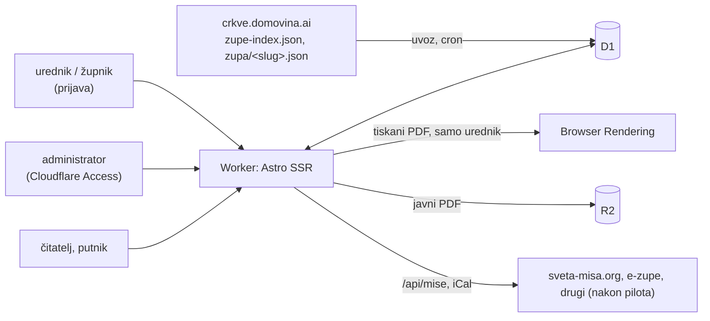

# Plan: listici.domovina.ai po sesijama

Napisano 2026-11-20 na kraju R2 (S0 ovog lanca). Koda još nema.

## Zašto

Župni listić je danas Wordov dokument, objavljen kao PDF ili slika na webu i Facebooku,
pa raspored misa nije strojno čitljiv (R1: 27 od 63 listića iz Worda). Ovdje župnik
složi listić u obrascu, dobije PDF za tisak i objavi ga jednim klikom, a raspored misa
za cijelu Hrvatsku nastaje kao nusproizvod. Postojeći servisi rasporeda održavaju ga
odvojeno i zastarijeva (R2 § 4).

## Arhitektura

| Dio | Odluka |
|---|---|
| Stack | Astro 7 SSR + `@astrojs/cloudflare`, D1, R2, Browser Rendering; predložak `../omm.domovina.ai` (odluka 2) |
| Župe | uvoz iz crkve.domovina.ai, ključ slug + OIB/SBT_ID (odluka 3) |
| Model | profil župe + broj listića; misa kao zaseban zapis (odluke 101, 104, shema u `docs/research/2026-11-20-obrazac-listica.md`) |
| Identitet | prvi urednik preko službenog kontakta iz biskupijskog adresara, ostali pozivnicom (200–202) |
| Osobni podaci | nikad na webu, u javnom PDF-u ni u API-ju; dva PDF-a (203, 204, 103) |
| Liturgija | romcal + hrvatski nazivi, navod + poveznica, puni tekst ručno (105, 205) |

## Tvrdi uvjeti (svaka sesija)

- Repo je javan (MIT). Tuđi listići (`data/uzorci/`) nikad u git.
- Osjetljive sekcije (odluka 204) ne izlaze na web, u javni PDF ni u API. Svaka ruta
  koja vraća broj listića ima test koji to provjerava.
- Nema produkcijskog deploya ni vlastite domene prije S9. Do tada samo
  `wrangler dev --local` i testovi.
- Telefon, web i koordinate koje crkve ima iz Google Placesa se ne preuzimaju (odluka 3).
- `npm run check` (astro check + vitest) je zelen na kraju svake sesije; testovi bez
  mreže, `skipped 0`.

## Sesije

| # | Faza | Paket | Odluke | Gotovo kad |
|---|---|---|---|---|
| S1 | F0 temelj | kostur (Astro + Worker + D1 po omm), `npm run check`, uvoz župa iz crkve | 300 | `npm run check` zelen; lokalna D1 ima onoliko župa koliko `zupe-index.json` ima `kind == "zupa"` (broj zapisan); `/zupa/<slug>` radi u `wrangler dev --local` |
| S2 | F0 temelj | model listića: migracije, tipovi, validacija po shemi R1, tjedne mise iz stalnog rasporeda | 400 | testovi pokrivaju svih 5 oblika rasporeda iz R1 i iznimke; JSON primjer iz obrasca prolazi validaciju |
| S3 | F0 temelj | liturgijski kalendar: romcal + hrvatski nazivi, navod čitanja (izmjeriti izvor) | 500 | za 20 datuma iz 2026./2027. naziv, godina, boja i svetac odgovaraju HILP-ovu kalendaru (tablica u testu s izvorom) |
| S4 | F1 urednik | identitet: prijava (e-mail kod + passkey), uloge, zahtjev za župu, admin red provjera, pozivnice, dnevnik | 600 | e2e lokalno: zahtjev → provjera → župnik poziva urednika → urednik vidi samo svoju župu; testovi pravila iz 201 |
| S5 | F1 urednik | uređivač profila župe: crkve, stalni raspored, kontakt, stalni blokovi | 700 | urednik lokalno složi profil župe iz R1 uzorka (npr. Jastrebarsko) bez greške; testovi validacije |
| S6 | F1 urednik | uređivač broja: liturgija automatski, tjedne mise predpopunjene, obavijesti, slobodni i osjetljivi blokovi | 800 | lokalno složen broj koji sadržajno odgovara jednom R1 listiću; osjetljivi blokovi označeni |
| S7 | F2 izlaz | PDF: A4 dva stupca i A5 knjižica; tiskani i javni; HTML prikaz broja | 900 | oba PDF-a za broj iz S6; test da javni PDF i HTML nemaju nijedan osjetljivi blok |
| S8 | F2 izlaz | javni web i API: stranica župe, arhiva, „mise u blizini”, `/api/mise`, iCal, privatnost | 1000 | e2e lokalno; API shema dokumentirana; test „nikad nakane” na svim javnim rutama |
| S9 | F3 puštanje | sigurnost (rate limit, CSP, `/security-review`), impresum, **produkcijski deploy** | 1100 | **vrata**: korisnik odobri domenu i deploy; nakon toga produkcija odgovara, uvoz radi na cronu |
| S10 | F3 puštanje | **pilot s prvim župnikom**: onboarding, mjerenje, ispravci | 1200 | **vrata**: korisnik ima župnika; izmjereno vrijeme izrade broja i popis ispravaka |

Procjena: 10 sesija do pilota. Paralelno se može samo S3 uz S2 (ne dijele datoteke osim
`package.json`); ostalo je linearno.

**Vrata (lanac staje dok korisnik ne odluči):**
- prije S4: model identiteta (odluka 200) potvrđen;
- S9: produkcijski deploy i ime domene;
- S10: prvi stvarni župnik;
- kontakt s biskupijom (odluka 202) i sve što bi objavilo osobne podatke (odluka 203):
  izvan lanca, nema sesije dok korisnik ne odluči.

**Najrizičnije:** S4 (identitet; pogreška znači lažni raspored misa), S6 (urednik mora
biti brži nego u Wordu, inače pilot ne uspije) i S7 (PDF mora izgledati kao listić koji
župnik danas tiska). S3 je rizik ako romcal ne daje navode čitanja: tada S3 mjeri i
predlaže izvor, a navod je ručni unos do odluke.

## Gdje smo

S0 (R2): plan napisan, koda nema. Sljedeće: S1.
